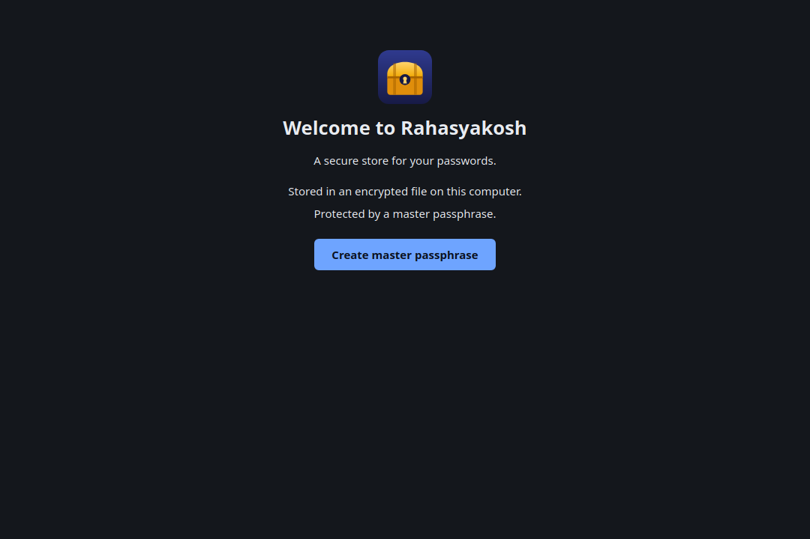
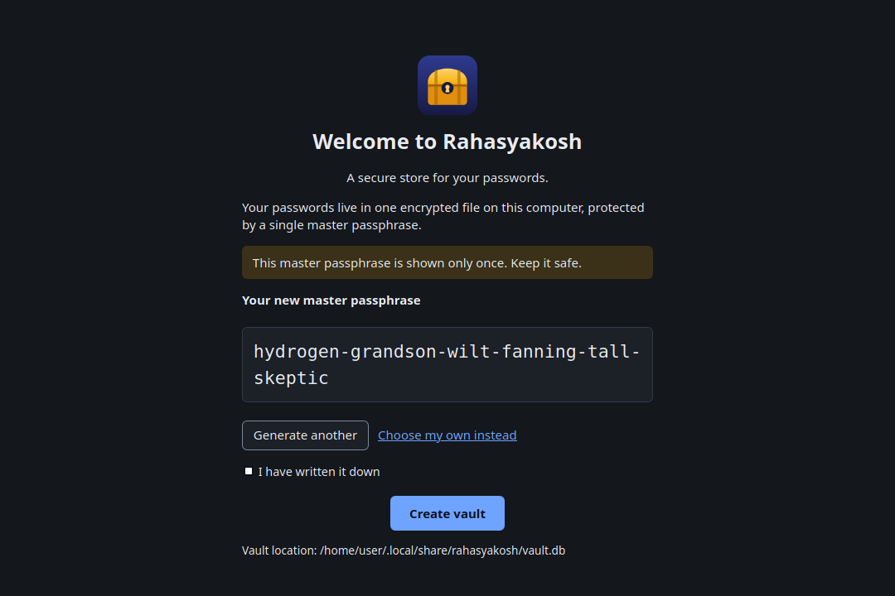
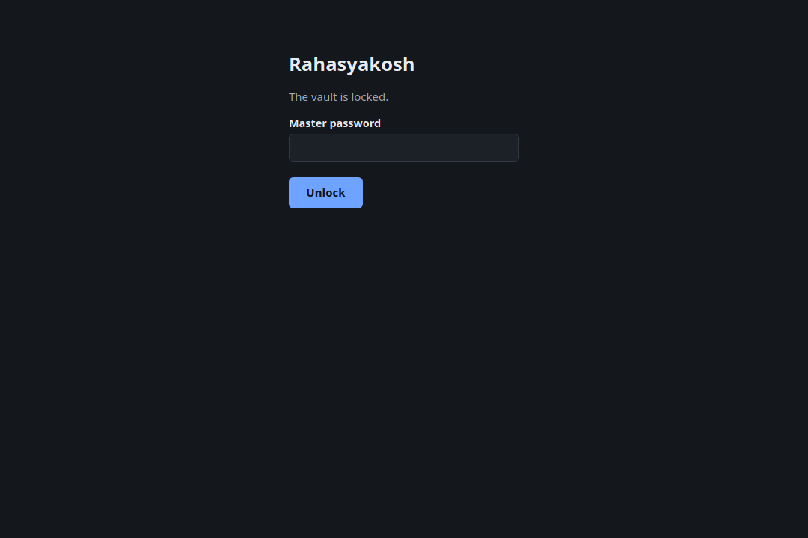
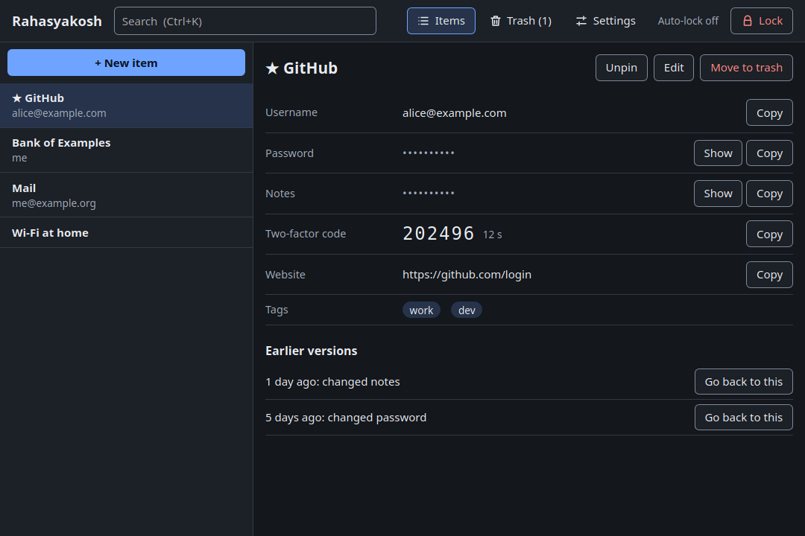
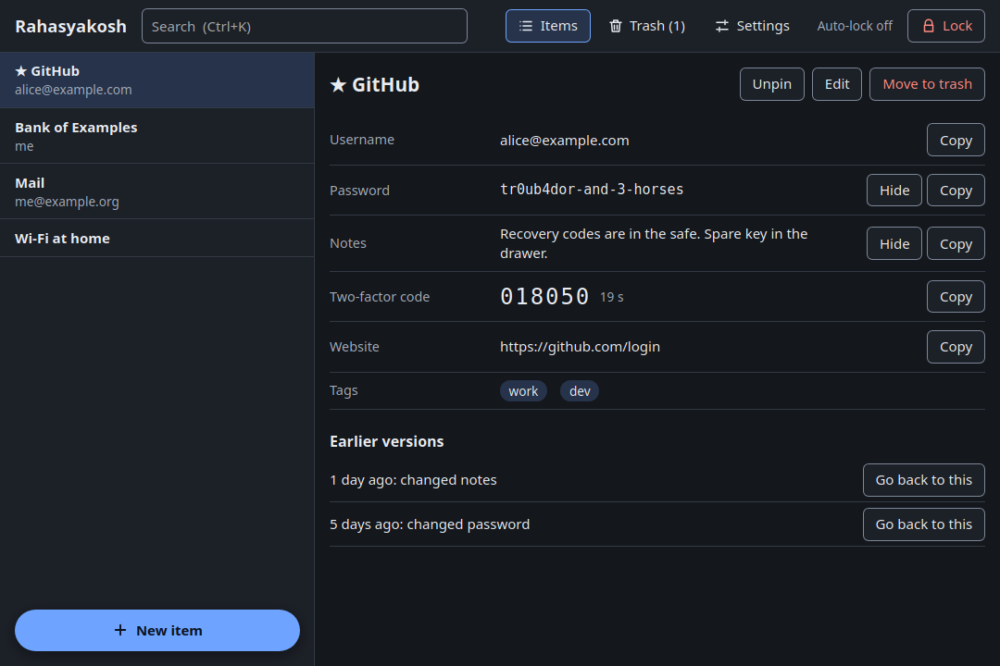
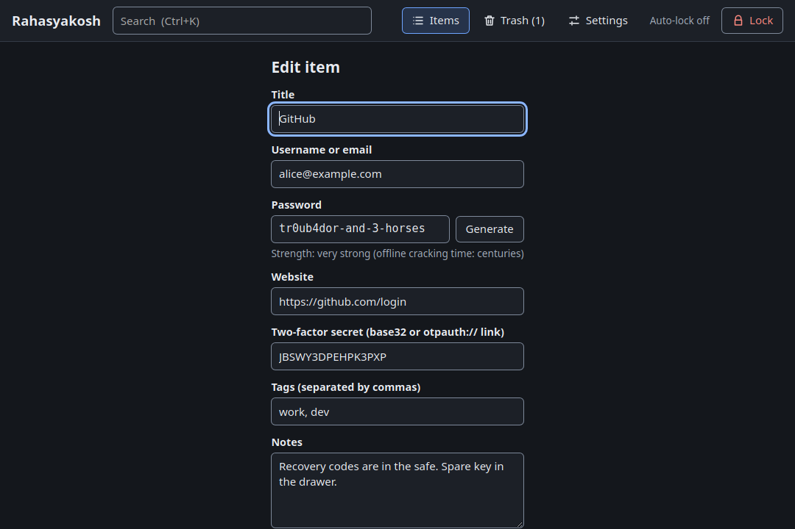

# The desktop app

Besides the command-line tool `rk`, Rahasyakosh has a desktop app (`apps/desktop`) for Linux. It opens the **same vault file** as `rk`
(`~/.local/share/rahasyakosh/vault.db` by default), so you can use either, or both.

> **Not audited yet**, like everything here. See [Quick start](quick-start.md) for what that means.

## Install

You need the build libraries once, and a Rust toolchain:

```
sudo apt install libwebkit2gtk-4.1-dev libgtk-3-dev libxdo-dev libayatana-appindicator3-dev libsoup-3.0-dev
cd apps/desktop
./install-local.sh            # builds, then installs into ~/.local only
```

It puts `rahasyakosh-desktop` in `~/.local/bin`, a launcher entry in your app grid ("Rahasyakosh") and an icon. Nothing outside `~/.local` is touched, and
`./install-local.sh --uninstall` removes it again (your vault and settings are left alone). To just try it without installing, run `cargo run --release` in `apps/desktop`.

## First run

If there is no vault yet, the app opens on a short welcome page. Click **Create master passphrase** to go on.



The next page, **Create a master passphrase**, generates a six-word **master passphrase** and shows it once, with the note "This master passphrase is shown only once. Keep it safe." Write it down (on paper is best), then tick the box; **Create vault** stays greyed out until you do. The copy icon in the corner of the passphrase puts it on the clipboard, and the app clears it again after the usual delay (20 seconds unless you changed it in Settings) if nothing else has been copied since. You can
instead type your own password, and the app rates its strength and refuses weak ones. **There is no way to recover a lost master passphrase.**



## Unlocking



Type the master password and press Enter. After three wrong passwords in a row the app makes you wait 1 s, then 2 s, 4 s and so on (see [Sessions](sessions.md)).

## The main window



- **Left:** your items. Pinned favourites (★) come first. **Ctrl+K** jumps to the search box; searching looks in titles, usernames, websites and tags, never in passwords or notes. A **New item** bar floats at the bottom of the list, so it stays in reach however long the list is; hover over it to see its shortcut, **Ctrl+N**.
- **Right:** the selected item. Passwords and notes show as dots until you press **Show**, then hide again after 10 seconds (or press **Hide**).
  **Copy** puts a value on the clipboard and clears it after 20 seconds, if you have not copied something else meanwhile.
  The buttons on the right have icons and shortcuts too; hover over one to see its shortcut. They work while an item is open:

  | Button | Shortcut |
  |---|---|
  | Pin / Unpin | **Ctrl+P** |
  | Edit | **Ctrl+E** |
  | Move to trash | **Ctrl+D** |
  | Copy password | **Ctrl+Shift+C** |
  | Copy username | **Ctrl+Shift+U** |
  | Copy website | **Ctrl+Shift+W** |
  | Copy two-factor code | **Ctrl+Shift+T** |
  | Show / Hide password | **Ctrl+Shift+S** |

  The copy and show shortcuts use Shift so that plain **Ctrl+C** keeps copying selected text as usual. Notes have no shortcut; use their buttons.
- **Two-factor code:** if the item has a two-factor secret, the current six-digit code is shown with its countdown. The secret itself is never displayed.
- **Earlier versions:** each time you change an item, the old version is kept. **Go back to this** restores one (the present content is kept too).
- **Top bar:** **Items**, **Trash** (deleted items, restorable, emptied after 30 days), **Settings**, a countdown to the automatic lock, and **Lock** to lock right now. Each button has an icon and a keyboard shortcut, shown when you hover over it:

  | Button | Shortcut |
  |---|---|
  | Items | **Ctrl+1** |
  | Trash | **Ctrl+2** |
  | Settings | **Ctrl+3** |
  | Lock | **Ctrl+L** |
  | New item | **Ctrl+N** |

  The buttons show an icon and text by default. **Settings → Top-bar buttons show** switches them to text only or icons only (the name stays available to screen readers either way).
  **Settings → Colour scheme** chooses light, dark, or "Same as the system" (the default); the change shows as soon as you save.
  **Settings → Language** chooses the language of the whole app (see [Languages](#languages) below).



### Adding and editing

**+ New item** and **Edit** open a form. **Generate** fills in a strong random password, and a strength meter rates what is typed. The two-factor field accepts either the base32 secret or the
`otpauth://` link from a QR code's text. Tags are separated by commas.



## What the app does to protect you

| Behaviour | Why |
|---|---|
| Locks itself after 5 minutes without activity (adjustable) | A vault left open on an unattended computer closes itself |
| Optionally locks when the window loses focus | For shared or shoulder-surfing situations |
| Locking wipes keys, items, the search results and everything revealed | Nothing readable stays in the app's memory after a lock |
| Locking, or closing the window, clears a copied password from the clipboard | So it cannot outlive the session |
| Passwords and notes are dots until shown, and hide again on a timer | Over-the-shoulder and screen-sharing safety |
| Wrong-password waits (1 s, 2 s, 4 s … 5 min) | Slows guessing at the keyboard |
| Settings file holds no secrets and cannot weaken the vault | Key-derivation cost has a floor that a settings file cannot lower |

The details, and what they cannot do, are in [Sessions: locking, hiding and clearing](sessions.md).

## Settings

Under **Settings**: auto-lock minutes, lock on focus loss, how long a copied password stays on the clipboard, how long a shown password stays visible,
how long deleted items are kept, history length, whether the top-bar buttons show icons and text, text only or icons only, whether the app is light, dark or follows the system, the display language, and the cost of the password-guessing protection (applied when a vault is created or its master password is changed).
You can also **change the master password** there (the new one must pass the strength check).

## Languages

The app can be shown in **English, हिन्दी (Hindi), संस्कृतम् (Sanskrit), தமிழ் (Tamil), తెలుగు (Telugu), മലയാളം (Malayalam) and اردو (Urdu)** (US-I18N-01).
Choose one under **Settings → Language** and press **Save settings**; the whole window changes at once. On the very first screen, before a vault exists, a language list sits under the welcome text, and the choice is saved with the new vault's settings.

- **Where the text lives.** Every word the app shows is in one file, `apps/desktop/src/i18n.rs`, as a row of seven strings (one per language). A message cannot be added without all seven, because the program would not compile. Tests check that no entry is empty, that every language keeps the same `{0}` slots as the English text (the slots are where a number or name is put in, and each language may move them to suit its grammar), and that each translation really is written in its script.
- **Right to left.** Urdu is written right to left, so choosing it turns the whole page around: the item list moves to the right, the top bar and buttons are mirrored, text lines up on the right, and the arrows and borders swap sides. Passwords, web addresses and two-factor codes stay left to right inside this mirrored page, because they are made of Latin letters and digits and would be hard to check by eye if reversed.
- **Numbers** are shown with the digits 0–9 in every language.
- **Still in English:** text produced by other libraries (the password-strength warnings such as "this is a very common password", and the estimated cracking time) and low-level error details from the vault file.
- **Fonts.** The app uses your system's fonts, so the scripts show properly only if your computer has fonts for them (most Linux desktops include Noto fonts for all of these).
- **Please review the translations.** They were written by an AI assistant, not by native speakers. The Sanskrit in particular uses simple formal phrasing and deserves a proper review. Corrections are welcome and only need edits to `i18n.rs`.

**Not checked on screen yet:** the layout in Urdu (right to left) has been built and its logic tested, but nobody has looked at it in a running window.

## What it does not do yet

- **No system-tray icon and no global quick-search shortcut** (US-DSK-01). On Wayland, which is the default on current Ubuntu, programs are not allowed to listen for keys while another window has focus, so a global shortcut needs a desktop-specific
  portal. Inside the window, **Ctrl+K** works.
- **Linux only.** macOS and Windows need their own clipboard handling and packaging.
- **No import or export screen.** Use `rk import` and `rk export` (see [Importing and exporting](import-export.md)).
- **No browser autofill and no syncing between devices.**
- **It has had a desk review and a first Orca test pass for accessibility, with some items still open** (US-A11Y-01). See [Accessibility](#accessibility) below.

## Accessibility

Accessibility means people who cannot use a mouse, cannot see the screen, or need strong contrast can still use the app. What has been done (US-A11Y-01):

- **Keyboard only.** Everything is a real button, link or form field, so Tab, Shift+Tab, Enter and Space work, and a thick outline shows where you are. **Ctrl+K** jumps to search.
- **Screen-reader names.** A screen reader reads a button's label out of context, so a row of identical "Copy" buttons would be useless. Each one now says what it acts on ("Copy Password", "Show Password", "Copy two-factor code"). A hidden password is announced as "Password is hidden", not as ten dots. The menu says which page you are on, and the list says which item is selected.
- **Secrets are not read aloud.** An earlier version marked the whole detail pane as a "live region", which makes a screen reader speak every change. That would have read out a revealed password, and the two-factor code every 30 seconds. The pane is no longer live; only short notices ("Copied", errors) are announced.
- **Contrast.** Text meets WCAG 2.2 level AA (at least 4.5 to 1), and the edges of fields and buttons and the focus outline meet 3 to 1, in both light and dark mode. A test (`cargo test` in `apps/desktop`) measures every colour pair, so a later colour change that breaks this fails the build.
- **No colour-only meaning.** Errors and successes are written out in words; the pinned star is also spelled "Pinned" for screen readers.

**Known limitation: start your screen reader before the app.** If you open the app first and turn Orca on afterwards, Orca may not connect to the window. The signs are that it reads out every key you type (including your master password characters) and stays silent about errors. Quit the app and open it again after Orca is running, and everything works. The cause is that the desktop's accessibility service is switched off until a screen reader starts, and the web view that draws the window only connects to it when it starts. The app-grid launcher installed by `install-local.sh` switches the service on first, which should avoid the problem; if you run `rahasyakosh-desktop` directly, start Orca first.

**Done so far:** an Orca test pass found and fixed several problems (the unlock box, Esc, announcements of errors, locking and show/hide, errors in forms, and a layout problem at 200% zoom). The test lists are in `docs/08-a11y-test-checklist.md` and `docs/09-shortcuts-test-checklist.md`; some items are still open, so this is not yet a full pass.

**Not done:** large text and 200% zoom have only been partly checked, and not everyone's setup has been tried. Only one tester has used the app with a real screen reader so far. If you rely on assistive software, your feedback is the most useful thing you can give.

### Files the app creates besides your vault

The web view keeps a few files of its own in `~/.local/share/rahasyakosh-desktop/` and `~/.cache/rahasyakosh-desktop/` (empty "salt" files and a small
browser-engine database). They hold no vault content and are safe to delete. The app turns off the browser's autofill and password saving on its fields.

### Things worth knowing about how it is built

- The window is drawn by **WebKitGTK**, the same engine behind GNOME's built-in browser, using the [Dioxus](https://dioxuslabs.com) Rust UI framework. Typed text lives in that engine's memory while you type it, which the app cannot wipe.
  Everything the vault needs (keys, items, the session) lives in our own Rust code and is wiped as described.
- Dioxus pulls in the system **OpenSSL** library through a websocket helper it uses between the app and its own web view. That connection never carries vault data and never leaves your computer, and our own cryptography does not use OpenSSL.
  We do not allow OpenSSL anywhere else; the desktop app has its own supply-chain policy (`apps/desktop/deny.toml`) that permits it only through that one dependency, with every other exception written down and explained.

## How it is built and tested

The screens only draw and forward clicks. Everything they *do* (unlocking, hiding and revealing, copying and clearing, forms and their checks, trash and history, settings, the first-run choices)
lives in a plain `Model` in `apps/desktop/src/model.rs`, with no window in it. 19 tests exercise it with an in-memory vault and a fake clipboard, including the complete "copy, wait, clear unless replaced" flow and the idle lock.

To look at the design, the **gallery** (`GALLERY=detail cargo run --example gallery`, also `revealed`, `form`, `settings`, `trash`) opens a screen on sample data in an in-memory vault, so it never touches your real one. The screenshots in this chapter are from the real running app.
